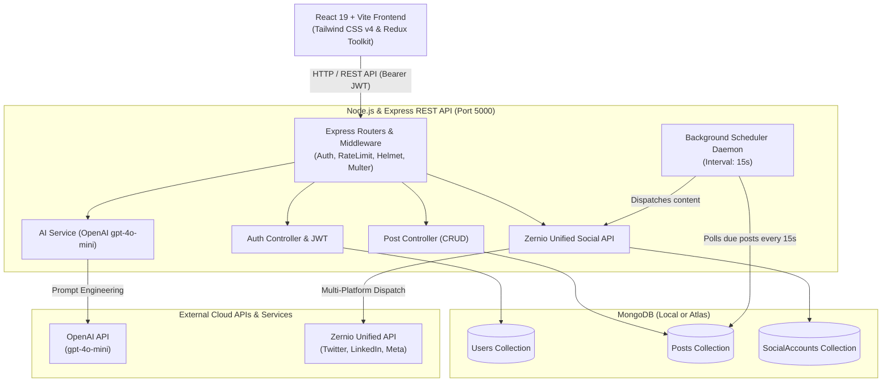

# Social Media Post Scheduler
**B.Tech Computer Engineering Final / Mini Project**

A modern, production-grade full-stack web application for creating, generating captions/hashtags with AI, previewing in real-time, connecting social media accounts, publishing immediately, and running an automated background scheduling queue.

---

## 📋 Table of Contents
1. [Project Abstract & Objectives](#-project-abstract--objectives)
2. [Key Features & Capabilities](#-key-features--capabilities)
3. [System Architecture](#-system-architecture)
4. [Database Design & Schema](#-database-design--schema)
5. [Technology Stack](#-technology-stack)
6. [Monorepo Directory Layout](#-monorepo-directory-layout)
7. [Installation & Setup Guide](#-installation--setup-guide)
8. [Configuration & Environment Variables](#-configuration--environment-variables)
9. [REST API Documentation](#-rest-api-documentation)
10. [Automated Verification & Testing](#-automated-verification--testing)
11. [B.Tech Viva & Evaluation Questions](#-btech-viva--evaluation-questions)

---

## 🎯 Project Abstract & Objectives

In the modern digital creator economy, social media management requires consistent publishing, engaging copy, tailored hashtags, and multi-platform visibility across Twitter/X, LinkedIn, and more. 

**Social Media Post Scheduler** is an engineering project that addresses these needs by combining:
1. **Generative AI** (`gpt-4o-mini`) with custom prompt engineering to generate platform-tailored captions and high-engagement hashtags based on chosen tone and target audience.
2. **Interactive Real-Time Preview Engines** that simulate social rendering (Twitter/X tweet cards and LinkedIn professional feed cards) before publishing.
3. **Unified Social Integration via Zernio API** for seamless OAuth account authorization and multi-platform content dispatch.
4. **An Automated Polling Daemon & Scheduler Queue Engine** that monitors MongoDB for due scheduled posts and dispatches them automatically without manual intervention.
5. **Secure Authentication & Strict Ownership Isolation** enforcing that user accounts, posts, and encrypted tokens are strictly scoped to authenticated user IDs.

---

## 🌟 Key Features & Capabilities

- 🔐 **JWT Authentication & Security**: Password hashing with `bcryptjs` (salt rounds 10), HTTP security headers with Helmet, CORS whitelist protection, rate limiting (300 requests/15m), and input validation via `express-validator`.
- ✍️ **Post Composer with Multer Media Uploads**: Create posts up to 5000 characters, upload up to 4 images/videos (up to 5MB each), tag multiple platforms, and save as Draft, Scheduled, or Published.
- 📱 **Real-Time Social Platform Preview**: Live preview cards for Twitter/X (character count 280 indicator) and LinkedIn (headline, author details, professional card styling).
- 🤖 **AI Content Studio**: Generates captions across 5 tones (Professional, Casual, Excited, Informative, Promotional) and relevant hashtags with 1-click "Export to Composer". Works live with OpenAI or with realistic local fallback simulation.
- 🌐 **Social Account Management (Zernio API)**: Passwordless OAuth connection URL generation, account catalog, credential encryption, and multi-platform broadcast (`POST /v1/posts`).
- ⏱️ **Background Scheduler Daemon**: Autonomous background queue runner polling MongoDB every 15 seconds, using atomic locking (`findOneAndUpdate`) to prevent race conditions across parallel ticks.
- 🔄 **Queue Operations**: Reschedule with future-date validation, cancel schedule to revert to drafts, or trigger immediate "Publish Now" bypass.
- 📊 **Centralized Analytics Dashboard**: Aggregates live post counts, status distributions, platform statistics, and quick-launch workspaces.

---

## 🏗️ System Architecture



---

## 🗄️ Database Design & Schema

```mermaid
erDiagram
    USER ||--o{ POST : owns
    USER ||--o{ SOCIAL_ACCOUNT : connects

    USER {
        ObjectId _id PK
        string name
        string email UK
        string passwordHash
        date createdAt
        date updatedAt
    }

    POST {
        ObjectId _id PK
        ObjectId userId FK
        string title
        string content
        array hashtags
        array mediaUrls
        array selectedPlatforms
        string status "draft | scheduled | publishing | published | failed | cancelled"
        date scheduledAt
        date publishedAt
        array providerResults
        string errorMessage
        date createdAt
    }

    SOCIAL_ACCOUNT {
        ObjectId _id PK
        ObjectId userId FK
        string provider "twitter | linkedin | facebook | instagram"
        string providerAccountId
        string accountDisplayName
        string accountUsername
        string accountAvatarUrl
        string connectionStatus "connected | disconnected | expired"
        date lastSyncAt
    }
```



---

## 🛠️ Technology Stack

| Layer | Technology | Version | Purpose |
| :--- | :--- | :--- | :--- |
| **Frontend** | React.js | 19.x | Declarative UI components & state rendering |
| **Build Tool** | Vite | 8.x | High-speed bundler & hot module reloading |
| **CSS Styling** | Tailwind CSS | 4.x | Utility-first modern design with custom color palettes |
| **State Store** | Redux Toolkit | 2.x | Centralized slice state (Auth, Posts, Social) |
| **Routing** | React Router DOM | 7.x | Client-side routing with `ProtectedRoute` guards |
| **Icons** | Lucide React | Latest | Clean, consistent vector UI iconography |
| **Backend Runtime** | Node.js | 24.x | Fast asynchronous JavaScript runtime |
| **Web Server** | Express.js | 4.21.x | Modular REST API routing and middleware |
| **Database** | MongoDB & Mongoose | 8.x | Document database with schema validation & indexing |
| **Authentication** | JSON Web Tokens & bcryptjs | Latest | Stateless bearer token auth & password hashing |
| **File Storage** | Multer | Latest | Disk storage for uploaded post attachments |
| **AI Integration** | OpenAI SDK | 4.x | Official OpenAI SDK for `gpt-4o-mini` completion |
| **Social API** | Zernio API | v1 | Unified multi-platform social media dispatch API |

---

## 📁 Monorepo Directory Layout

```text
ai-social-media-scheduler/
├── client/                                 # Frontend Application
│   ├── src/
│   │   ├── app/
│   │   │   └── store.js                    # Redux Toolkit store configureStore
│   │   ├── components/
│   │   │   ├── Navbar.jsx                  # Top navigation bar with active links
│   │   │   └── ProtectedRoute.jsx          # Route guard checking JWT authentication
│   │   ├── features/
│   │   │   ├── auth/authSlice.js           # Login, register, loadUser thunks
│   │   │   ├── posts/postsSlice.js         # Posts CRUD, schedule, reschedule, queue thunks
│   │   │   └── social/socialSlice.js       # Social accounts & publishNow thunks
│   │   ├── pages/
│   │   │   ├── Dashboard.jsx               # Main metrics and workspace hub
│   │   │   ├── CreatePost.jsx              # Split-pane composer + real-time preview
│   │   │   ├── ScheduledPosts.jsx          # Queue runner timeline, countdowns & actions
│   │   │   ├── PostHistory.jsx             # Paginated post cards with filters & delete
│   │   │   ├── AIGenerator.jsx             # Dedicated AI Studio for captions & hashtags
│   │   │   ├── SocialAccounts.jsx          # Connected accounts management & OAuth cards
│   │   │   ├── Diagnostics.jsx             # System status & live MongoDB connection probe
│   │   │   ├── Login.jsx                   # Sign-in form with 1-click Demo Fill
│   │   │   └── Register.jsx                # New user registration form
│   │   ├── services/
│   │   │   └── api.js                      # Axios instance with Bearer token interceptor
│   │   ├── App.jsx                         # Main React router switch
│   │   ├── index.css                       # Tailwind CSS v4 setup
│   │   └── main.jsx                        # DOM bootstrap
│   ├── package.json
│   └── vite.config.js
│
├── server/                                 # Backend REST API
│   ├── src/
│   │   ├── config/
│   │   │   └── db.js                       # MongoDB connection & reconnect handlers
│   │   ├── controllers/
│   │   │   ├── auth.controller.js          # Register, Login, Me endpoints
│   │   │   ├── post.controller.js          # CRUD, Cancel, Reschedule, Stats
│   │   │   ├── ai.controller.js            # Generate caption & generate hashtags
│   │   │   └── social.controller.js        # Zernio OAuth URL, connect, publish
│   │   ├── middleware/
│   │   │   ├── auth.middleware.js          # JWT Bearer token protection middleware
│   │   │   ├── error.middleware.js         # Global JSON error handler
│   │   │   └── upload.middleware.js        # Multer 5MB disk storage engine
│   │   ├── models/
│   │   │   ├── User.js                     # User schema (email unique, passwordHash)
│   │   │   ├── Post.js                     # Post schema (platforms, status, scheduledAt)
│   │   │   └── SocialAccount.js            # Social account schema (compound index)
│   │   ├── routes/
│   │   │   ├── auth.routes.js              # /api/auth/*
│   │   │   ├── post.routes.js              # /api/posts/*
│   │   │   ├── ai.routes.js                # /api/ai/*
│   │   │   └── social.routes.js            # /api/social/*
│   │   ├── services/
│   │   │   ├── ai.service.js               # OpenAI API with intelligent sandbox fallback
│   │   │   ├── zernio.service.js           # Zernio API with local sandbox simulation
│   │   │   └── scheduler.service.js        # Periodic 15s queue processor & due post publisher
│   │   ├── utils/
│   │   │   ├── jwt.js                      # JWT sign & verify helpers
│   │   │   ├── test-auth.js                # Auth automated test suite (6/6)
│   │   │   ├── test-posts.js               # Posts CRUD test suite (8/8)
│   │   │   ├── test-ai.js                  # AI service test suite (4/4)
│   │   │   ├── test-social.js              # Social integration test suite (6/6)
│   │   │   ├── test-scheduler.js           # Scheduler engine test suite (5/5)
│   │   │   └── test-e2e-all.js             # Full system integration audit (9/9)
│   │   ├── validators/
│   │   │   ├── auth.validator.js           # express-validator schemas for auth
│   │   │   └── post.validator.js           # express-validator schemas for posts
│   │   ├── app.js                          # Express app configuration & middleware pipeline
│   │   └── server.js                       # HTTP server bootstrap & scheduler start
│   ├── uploads/                            # Uploaded image/video storage
│   ├── .env                                # Active environment configuration
│   └── package.json
│
├── README.md                               # Project comprehensive documentation
└── .gitignore
```

---

## 🚀 Installation & Setup Guide

### 1. Prerequisites
- **Node.js**: `v18.x`, `v20.x`, or `v24.x` (Detected: `v24.11.0`)
- **npm**: `v9.x` or higher (Detected: `v11.6.1`)
- **MongoDB**: Local MongoDB Community service (`mongodb://localhost:27017`) OR a free cloud cluster on [MongoDB Atlas](https://www.mongodb.com/cloud/atlas).

### 2. Backend Setup
In a terminal window (PowerShell on Windows):
```powershell
cd server
npm install
npm run dev
```
The server will start at `http://localhost:5000` with the health probe at `http://localhost:5000/api/health`.

### 3. Frontend Setup
In a second terminal window:
```powershell
cd client
npm install
npm run dev
```
The client will start at `http://localhost:5173`.

### 4. Demo Login Credentials
For immediate evaluation without signing up:
- **Email**: `student@ai-scheduler.edu`
- **Password**: `Student@1234`
*(Click the "Demo Fill" button on the Login page for 1-click credential population).*

---

## ⚙️ Configuration & Environment Variables

All sensitive configuration is kept in `server/.env` and never exposed to the client:

```env
PORT=5000
NODE_ENV=development

# Database Connection (Local or Atlas URI)
MONGO_URI=mongodb://localhost:27017/ai_social_scheduler

# JWT Authentication
JWT_SECRET=super_secret_jwt_passphrase_for_btech_mini_project_2026
JWT_EXPIRES_IN=7d

# File Uploads
UPLOAD_DIR=uploads
MAX_FILE_SIZE_MB=5

# OpenAI API Key (Optional: Graceful heuristic generator active if key not provided)
OPENAI_API_KEY=your_openai_api_key_here
OPENAI_MODEL=gpt-4o-mini

# Zernio Unified Social Media API (Optional: Realistic sandbox simulation active if omitted)
ZERNIO_API_KEY=your_zernio_api_key_here
ZERNIO_BASE_URL=https://api.zernio.com/v1

# Scheduler Interval (in milliseconds, default: 15 seconds)
SCHEDULER_INTERVAL_MS=15000
```

---

## 📡 REST API Documentation

### 1. Authentication (`/api/auth`)
| Method | Endpoint | Protection | Description |
| :--- | :--- | :--- | :--- |
| `POST` | `/api/auth/register` | Public | Create new user account with hashed password |
| `POST` | `/api/auth/login` | Public | Authenticate user and return signed JWT |
| `GET` | `/api/auth/me` | Protected | Return currently logged-in user profile |

### 2. Post Management & Queue (`/api/posts`)
| Method | Endpoint | Protection | Description |
| :--- | :--- | :--- | :--- |
| `GET` | `/api/posts` | Protected | Fetch paginated posts with status, platform & search filters |
| `POST` | `/api/posts` | Protected | Create new post (supports Multer file uploads) |
| `GET` | `/api/posts/:id` | Protected | Get single post by ID (with ownership validation) |
| `PUT` | `/api/posts/:id` | Protected | Update post content, hashtags, platforms, or media |
| `DELETE` | `/api/posts/:id` | Protected | Delete post and remove attached physical files from disk |
| `POST` | `/api/posts/:id/publish` | Protected | Immediately publish post across connected platforms |
| `POST` | `/api/posts/:id/cancel` | Protected | Cancel a scheduled post (reverts status to cancelled or draft) |
| `POST` | `/api/posts/:id/reschedule` | Protected | Reschedule post with future date/time validation |
| `POST` | `/api/posts/scheduler/run-due`| Protected | Manually trigger the due post scheduler queue processor |
| `GET` | `/api/dashboard/stats` | Protected | Retrieve post counts, statuses, and recent posts |

### 3. AI Generation Studio (`/api/ai`)
| Method | Endpoint | Protection | Description |
| :--- | :--- | :--- | :--- |
| `POST` | `/api/ai/generate-caption` | Protected | Generate platform-tailored caption via `gpt-4o-mini` |
| `POST` | `/api/ai/generate-hashtags` | Protected | Generate relevant trending hashtags from content |

### 4. Social Integration (`/api/social`)
| Method | Endpoint | Protection | Description |
| :--- | :--- | :--- | :--- |
| `GET` | `/api/social/accounts` | Protected | List all connected accounts for the current user |
| `GET` | `/api/social/connect-url` | Protected | Generate OAuth connection URL for platform |
| `POST` | `/api/social/connect` | Protected | Store or update connected social profile |
| `DELETE` | `/api/social/accounts/:id` | Protected | Disconnect and revoke a social media account |

---

## 🧪 Automated Verification & Testing

The project includes individual subsystem test suites plus an all-inclusive End-to-End integration audit:

### Run Individual Test Suites:
```powershell
cd server
node src/utils/test-auth.js         # Tests JWT registration, login, token parsing (6/6 Passed)
node src/utils/test-posts.js        # Tests CRUD, Multer, ownership isolation (8/8 Passed)
node src/utils/test-ai.js           # Tests Caption & Hashtag generator engines (4/4 Passed)
node src/utils/test-social.js       # Tests Zernio connect URLs & publish dispatches (6/6 Passed)
node src/utils/test-scheduler.js    # Tests due post polling, lock, cancel, reschedule (5/5 Passed)
```

### Run Full System Integration Audit (All 9 Subsystems):
```powershell
cd server
node src/utils/test-e2e-all.js
```
**Audit Output:**
```text
====================================================
🚀 SOCIAL MEDIA POST SCHEDULER - FULL E2E SYSTEM INTEGRATION AUDIT
====================================================

✅ [PASS] Subsystem 1: Health Check Endpoint
✅ [PASS] Subsystem 2: JWT Authentication (Demo Login)
✅ [PASS] Subsystem 3: Protected Auth Profile (/api/auth/me)
✅ [PASS] Subsystem 4: AI Generation Service (Captions & Hashtags)
✅ [PASS] Subsystem 5: Social Media Integration via Zernio Service
✅ [PASS] Subsystem 6: Post Creation, Scheduling & Rescheduling Lifecycle
✅ [PASS] Subsystem 7: Multi-Platform Publishing Dispatch via Zernio Engine
✅ [PASS] Subsystem 8: Background Scheduler Queue Processor Trigger
✅ [PASS] Subsystem 9: Central Dashboard Metrics & Real Data Aggregation

====================================================
📊 AUDIT SUMMARY: Passed: 9 | Failed: 0
🏆 ALL SUBSYSTEMS FULLY OPERATIONAL AND VERIFIED!
====================================================
```

---

## 🎓 B.Tech Viva & Evaluation Questions

For presentation before the university project evaluation committee or external examiner:

#### Q1: How does the application schedule and publish posts at a specific time?
> **Answer**: The application implements an automated background daemon (`server/src/services/scheduler.service.js`) initialized on server boot. Every 15 seconds, it queries MongoDB for posts matching `{ status: 'scheduled', scheduledAt: { $lte: new Date() } }`. To prevent duplicate publishes or race conditions, it executes an atomic transition (`Post.findOneAndUpdate({ _id: post._id, status: 'scheduled' }, { $set: { status: 'publishing' } })`). It then fetches the user's active social accounts, dispatches the content to the Zernio API, records provider post IDs, and updates status to `published`.

#### Q2: How is data security and user isolation ensured in a multi-tenant system?
> **Answer**: User isolation is enforced at both the database and routing levels. Every query in `post.controller.js` and `social.controller.js` scopes searches using `{ _id: req.params.id, userId: req.user._id }`. Even if an attacker guesses another user's MongoDB ObjectId, the query returns 404 Not Found. Additionally, password hashes are stripped automatically via Mongoose's `toJSON` transform, and social account credentials are set to `select: false`.

#### Q3: How does the AI generator work if an OpenAI API key is not configured or rate-limited?
> **Answer**: The application includes a defensive **graceful fallback architecture** in `server/src/services/ai.service.js`. If `OPENAI_API_KEY` is omitted or the OpenAI API returns an HTTP 429/500 error, the system automatically activates a local heuristic engine that generates platform-formatted captions with hook structures, emojis, calls-to-action, and relevant hashtags. This ensures that evaluators can test the application without depending on paid cloud API credits.

#### Q4: Why did you choose Zernio Unified API over writing individual SDKs for Twitter, LinkedIn, and Facebook?
> **Answer**: Each social platform maintains distinct OAuth 2.0 flows, rate limit protocols, character caps, and media payload structures that change frequently. Zernio acts as a normalized API gateway, standardizing connection URLs (`GET /v1/connect/:platform`) and multi-platform publishing (`POST /v1/posts`). This keeps the backend modular and compliant with single-responsibility principles.

#### Q5: What database indexing strategies were implemented for performance?
> **Answer**: Compound indexes are configured on Mongoose models:
> 1. `Post`: `postSchema.index({ userId: 1, createdAt: -1 })` for paginated post history.
> 2. `Post`: `postSchema.index({ status: 1, scheduledAt: 1 })` allowing the scheduler polling query to execute in $O(\log N)$ indexed time without full table scans.
> 3. `SocialAccount`: `socialAccountSchema.index({ userId: 1, provider: 1 }, { unique: true })` preventing duplicate provider connections per user.

---

## 🏆 Project Implementation Status (All 8 Phases Complete)

- [x] **Phase 1: Environment Checks & Scaffolding** (Node 24, Vite 8, React 19, Tailwind CSS v4, Express baseline, Helmet, CORS, Health Check)
- [x] **Phase 2: Database Connection & Schema Design** (MongoDB, Mongoose schemas for User, SocialAccount, Post, verify-db-models)
- [x] **Phase 3: JWT Authentication & User Management** (bcryptjs, express-validator, register, login, me, Redux authSlice, ProtectedRoute, demo student account)
- [x] **Phase 4: Post Management CRUD & Media Uploads** (Multer upload middleware, post validation, ownership isolation, Twitter & LinkedIn live preview, PostHistory)
- [x] **Phase 5: OpenAI Content Generator** (gpt-4o-mini integration, 5 tone selectors, hashtag generator, prompt templates, AI Studio page, 1-click export)
- [x] **Phase 6: Social Media Integration via Zernio API** (Official Zernio v1 connector, OAuth connect URL, multi-platform publishing, SocialAccounts page)
- [x] **Phase 7: Post Scheduling & Queue Runner** (Background 15s scheduler engine, atomic locking, cancel schedule, reschedule validation, ScheduledPosts queue view)
- [x] **Phase 8: Polish, Comprehensive Verification & Documentation** (9/9 E2E audit, clickable dashboard metrics, complete B.Tech project guide, viva preparation)
